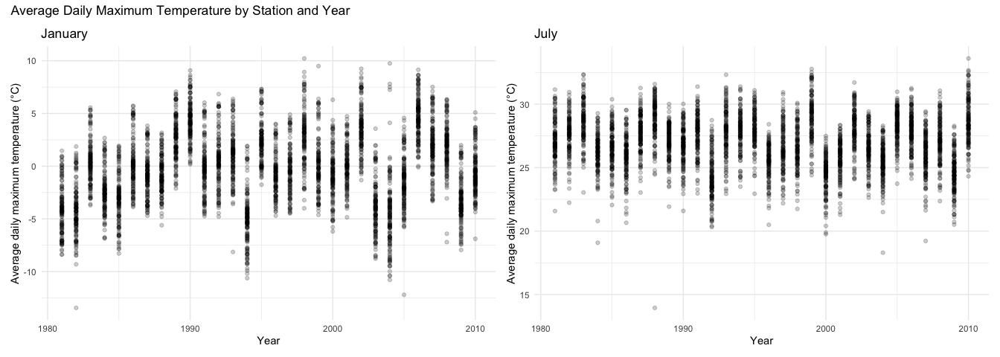
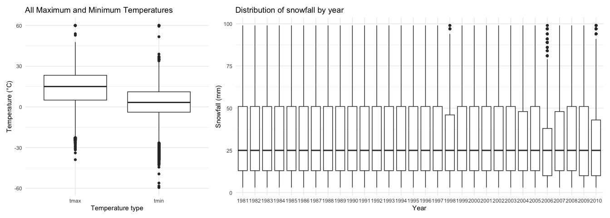
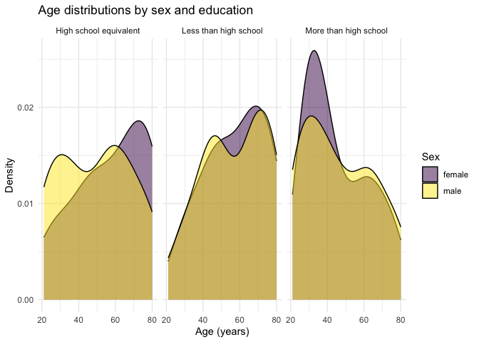
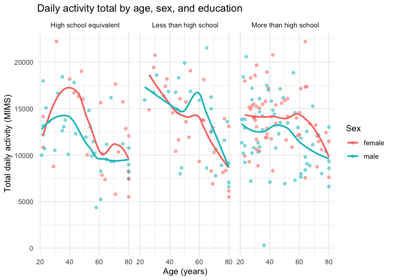
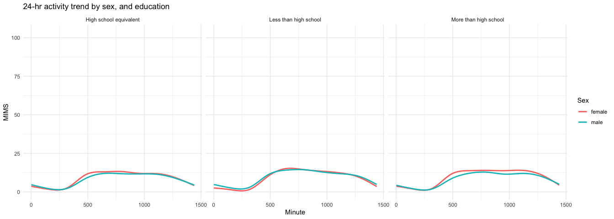

HW3 for P8105
================

Loading packages and data:

``` r
library(tidyverse)
```

    ## ── Attaching core tidyverse packages ──────────────────────── tidyverse 2.0.0 ──
    ## ✔ dplyr     1.2.1     ✔ readr     2.2.0
    ## ✔ forcats   1.0.1     ✔ stringr   1.6.0
    ## ✔ ggplot2   4.0.3     ✔ tibble    3.3.1
    ## ✔ lubridate 1.9.5     ✔ tidyr     1.3.2
    ## ✔ purrr     1.2.2     
    ## ── Conflicts ────────────────────────────────────────── tidyverse_conflicts() ──
    ## ✖ dplyr::filter() masks stats::filter()
    ## ✖ dplyr::lag()    masks stats::lag()
    ## ℹ Use the conflicted package (<http://conflicted.r-lib.org/>) to force all conflicts to become errors

``` r
library(patchwork)
library(p8105.datasets)
data("ny_noaa")
```

# Problem 1

The NY NOAA dataset is compiled from the NOAA NCEI daily database of
summary stats from weather stations in the world. This data is focused
on the NY state weather stations.

The key variables are:

- id: weather station ID
- date: date of observation
- prcp: precipitation (in tenths of mm)
- snow: snowfall (mm)
- snwd: snow depth (mm)
- tmax: maximum temperature (tenths of degrees C)
- tmin: minimum temperature (tenths of degrees C)

There is extensive missing data.

``` r
ny_noaa |>
  summarize(
    across(
      everything(),
      ~ mean(is.na(.)) * 100
    )
  )
```

    ## # A tibble: 1 × 7
    ##      id  date  prcp  snow  snwd  tmax  tmin
    ##   <dbl> <dbl> <dbl> <dbl> <dbl> <dbl> <dbl>
    ## 1     0     0  5.62  14.7  22.8  43.7  43.7

We see that prcp has 5.6% missing, snow has 14.7% missing, snwd has
22.8% missing, tmax has 43.7% missing, and tmin has 43.7% missing

## We will clean the data

Generate seperate variables for month date and year. In addition convert
prcp, tmax, tmin to units of mm and degrees C respectively.

``` r
ny_noaa_df = 
  ny_noaa |> 
  janitor::clean_names() |>
  mutate(
    date = ymd(date),
    day = day(date),
    month = month(date),
    year = year(date)
  ) |>
  mutate(
    prcp = prcp / 10,
    tmax = as.numeric(tmax) / 10,
    tmin = as.numeric(tmin) / 10
  )
```

## Most common snow fall recorded

``` r
ny_noaa_df |>
  count(snow, sort = TRUE)
```

    ## # A tibble: 282 × 2
    ##     snow       n
    ##    <int>   <int>
    ##  1     0 2008508
    ##  2    NA  381221
    ##  3    25   31022
    ##  4    13   23095
    ##  5    51   18274
    ##  6    76   10173
    ##  7     8    9962
    ##  8     5    9748
    ##  9    38    9197
    ## 10     3    8790
    ## # ℹ 272 more rows

The most commonly recorded snow fall is 0 mm at 2008508.

## Displaying the average max temperature in January and July in each station across years

``` r
jan_ny_noaa_df =
  ny_noaa_df |>
  filter(month == 1) |>
  group_by(id, year) |>
  summarize(
    jan_tmax_average = mean(tmax, na.rm = TRUE)
  ) |>
  ggplot(aes(x = year, y = jan_tmax_average, group = id)) +
  geom_point(alpha = 0.2) +
  labs(
    title = "January",
    x = "Year",
    y = "Average daily maximum temperature (°C)"
  ) +
  theme_minimal()
```

    ## `summarise()` has regrouped the output.
    ## ℹ Summaries were computed grouped by id and year.
    ## ℹ Output is grouped by id.
    ## ℹ Use `summarise(.groups = "drop_last")` to silence this message.
    ## ℹ Use `summarise(.by = c(id, year))` for per-operation grouping
    ##   (`?dplyr::dplyr_by`) instead.

``` r
july_ny_noaa_df =
  ny_noaa_df |>
  filter(month == 7) |>
  group_by(id, year) |>
  summarize(
    july_tmax_average = mean(tmax, na.rm = TRUE)
  ) |>
  ggplot(aes(x = year, y = july_tmax_average, group = id)) +
  geom_point(alpha = 0.2) +
  labs(
    title = "July",
    x = "Year",
    y = "Average daily maximum temperature (°C)"
  ) +
  theme_minimal()
```

    ## `summarise()` has regrouped the output.
    ## ℹ Summaries were computed grouped by id and year.
    ## ℹ Output is grouped by id.
    ## ℹ Use `summarise(.groups = "drop_last")` to silence this message.
    ## ℹ Use `summarise(.by = c(id, year))` for per-operation grouping
    ##   (`?dplyr::dplyr_by`) instead.

``` r
jan_ny_noaa_df + july_ny_noaa_df + plot_annotation(
    title = "Average Daily Maximum Temperature by Station and Year"
  )
```

    ## Warning: Removed 2923 rows containing missing values or values outside the scale range
    ## (`geom_point()`).

    ## Warning: Removed 3047 rows containing missing values or values outside the scale range
    ## (`geom_point()`).

<!-- -->

In January, average max temperatures at each station on a yearly basis
tend to correlate with one another. For example, in 1990, temperatures
are generally all higher compared to in 2010 or 2009. It also seems that
the temperatures are overall increasing in January from 1981 to 1990.
The year to year variation seems less in July compared to Janauary. In
addition, July temperatures are overall higher than January, as
expected. There does seem to be outliers in the data as evidenced by
weather station points that are distant from the average for each month.
For example, in January 2005, there appears to be one station that has a
much lower average maximum temperature than the rest.

## Comparing T max and Tmin and Snowfall Values

We will create a violin plot for T max and Tmin and snow fall excluding
less than 0 mm and greater or equal to 100 mm

``` r
temperature_boxplot = 
  ny_noaa_df |>
  ggplot() +
  geom_boxplot(aes(x = "tmax", y = tmax), na.rm = TRUE) +
  geom_boxplot(aes(x = "tmin", y = tmin), na.rm = TRUE) +
  labs(
    title = "All Maximum and Minimum Temperatures",
    x = "Temperature type",
    y = "Temperature (°C)"
  ) +
  theme_minimal()

snowfall_boxplot = 
  ny_noaa_df |>
  filter(snow > 0, snow < 100) |>
  ggplot(aes(x = factor(year), y = snow)) +
  geom_boxplot() +
  labs(
    title = "Distribution of snowfall by year",
    x = "Year",
    y = "Snowfall (mm)"
  ) +
  theme_minimal()

temperature_boxplot + snowfall_boxplot + plot_layout(widths = c(1, 2))
```

<!-- -->

As expected, Tmax on average is higher than Tmin with a wider IQR. There
are outliers in both Tmin and Tmax as seen by the dots on the boxpllots.

For snowfall, the average snowfall appears to consistently be 25 mm with
outliers in 1998 2006 and 2010. This is in context of limiting our data
to only display snowfall from 0 to \< 100 mm.

# Problem 2

## Data importa and tidying

We merge the NHANES covars and accel data followed by excluding subjects
\< 21 years of age and anyone with missing demographic data. We convert
sex and education to factor variables with relevant labeling which is
more appropriate.

``` r
nhanes_covar =
  read.csv("./data/nhanes_covar.csv", skip = 4) |>
  janitor::clean_names()

nhanes_accel = 
  read.csv("./data/nhanes_accel.csv") |>
  janitor::clean_names()

nhanes_df = 
  nhanes_covar |>
  left_join(nhanes_accel, by = "seqn") |>
  filter(age >= 21) |>
  drop_na(sex, age, bmi, education) |>
  mutate(
    sex = 
      case_match(
        sex, 
        1 ~ "male", 
        2 ~ "female"),
    sex = as.factor(sex), 
    education = 
      case_match (
        education,
        1 ~ "Less than high school",
        2 ~ "High school equivalent",
        3 ~ "More than high school"),
    education = as.factor(education)
  )
```

    ## Warning: There was 1 warning in `mutate()`.
    ## ℹ In argument: `sex = case_match(sex, 1 ~ "male", 2 ~ "female")`.
    ## Caused by warning:
    ## ! `case_match()` was deprecated in dplyr 1.2.0.
    ## ℹ Please use `recode_values()` instead.

## Men and Women in Each Education Group

Here we display the amount of men in each education category and women
in each education category

``` r
nhanes_df |>
  group_by(sex, education) |> 
  summarize(count = n())
```

    ## `summarise()` has regrouped the output.
    ## ℹ Summaries were computed grouped by sex and education.
    ## ℹ Output is grouped by sex.
    ## ℹ Use `summarise(.groups = "drop_last")` to silence this message.
    ## ℹ Use `summarise(.by = c(sex, education))` for per-operation grouping
    ##   (`?dplyr::dplyr_by`) instead.

    ## # A tibble: 6 × 3
    ## # Groups:   sex [2]
    ##   sex    education              count
    ##   <fct>  <fct>                  <int>
    ## 1 female High school equivalent    23
    ## 2 female Less than high school     28
    ## 3 female More than high school     59
    ## 4 male   High school equivalent    35
    ## 5 male   Less than high school     27
    ## 6 male   More than high school     56

We see that a majority of females and males had more than a high school
education.

Now we display the age distributions of females and males with varying
educational levels.

``` r
nhanes_df |>
  select(education, sex, age) |>
  ggplot(aes(x = age, fill = sex)) +
  geom_density(alpha = 0.5, na.rm = TRUE) +
  facet_grid(~ education) +
  viridis::scale_fill_viridis(discrete = TRUE) +
  labs(
    title = "Age distributions by sex and education",
    x = "Age (years)",
    y = "Density",
    fill = "Sex"
  ) +
  theme_minimal()
```

<!-- --> We
see that older females more frequently completed high school equivalent
compared to older males. In addition, we see that younger females more
frequently completed more than high school than younger females. The
less than high school category is roughly similar.

## Plotting the total daily activity per individuals and educational group

We want to determine the daily activity total by age, sex, and education
level.

First we create a new data frame with a total activity variable.Then,
plot each total activity level vs age in each education group.

``` r
nhanes_df_total_activity = 
  nhanes_df |>
  mutate(
    total_activity = rowSums(pick(starts_with("min")))
  )
nhanes_df_total_activity |>
  ggplot(aes(x = age, y = total_activity, color = sex)) +
  geom_point(alpha = 0.5) +
  geom_smooth(se = FALSE) +
  facet_grid(~ education) +
  labs(
    title = "Daily activity total by age, sex, and education",
    x = "Age (years)",
    y = "Total daily activity (MIMS)",
    color = "Sex"
  ) +
  theme_minimal() +
  theme(legend.position = "right")
```

    ## `geom_smooth()` using method = 'loess' and formula = 'y ~ x'

<!-- -->
We’ve displayed three plots. We see that in those with high school
equivalent education, younger females seemed to be more active than
younger males. As age increased, the two trends seem to converge and
activity decreaes. In those who completed less than high school and more
than high school educations, females and male activity decreased with
increasing age.

## Plotting the trend in activity per each individual and educational group

Now we will plot the trend in daily activity level per sex and
educational group.Given the amount of datapoints, we will hide the
individual datapoints and only display the fitted curve to understand
the general trends.

``` r
nhanes_df_24h_acitivty =
  nhanes_df |>
  pivot_longer(
    cols = starts_with("min"),
    names_to = "minute",
    values_to = "activity"
  )|>
  mutate(
    minute = readr::parse_number(minute)
  ) |>
  ggplot(aes(x = minute, y = activity, color = sex)) +
  geom_point(alpha = 0) +
  geom_smooth(se = FALSE) +
  facet_grid(~ education) +
  labs(
    title = "24-hr activity trend by sex, and education",
    x = "Minute",
    y = "MIMS",
    color = "Sex"
  ) +
  theme_minimal() +
  theme(legend.position = "right")

nhanes_df_24h_acitivty
```

    ## `geom_smooth()` using method = 'gam' and formula = 'y ~ s(x, bs = "cs")'

<!-- -->

We see that across all educational groups and both sexes, activity is
low from 000 and rises around 0800h. Activity the decreases in the
evening time. This is expected.

# Problem 3

First we import and clean the data.

``` r
jan_2020_citi = 
  read.csv("./data/Jan 2020 Citi.csv") |>
  janitor::clean_names() |>
  mutate(month = "2020-01")

jan_2024_citi = 
  read.csv("./data/Jan 2024 Citi.csv") |>
  janitor::clean_names() |>
  mutate(month = "2024-01")

july_2020_citi = 
  read.csv("./data/July 2020 Citi.csv") |>
  janitor::clean_names() |>
  mutate(month = "2020-07")

july_2024_citi = 
  read.csv("./data/July 2024 Citi.csv") |>
  janitor::clean_names() |>
  mutate(month = "2024-07")

citi_df = 
  bind_rows(jan_2020_citi, july_2020_citi, jan_2024_citi, july_2024_citi) |>
  mutate(
    rideable_type = factor(rideable_type)
  )
```
